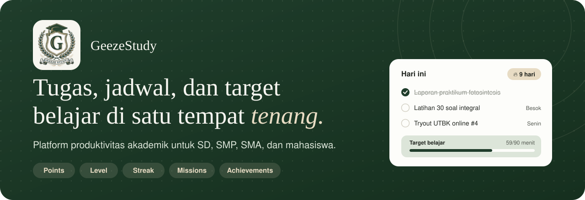
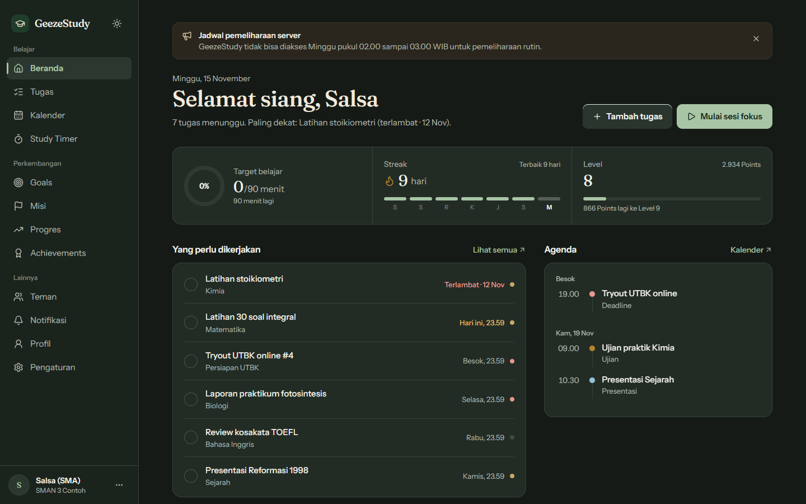
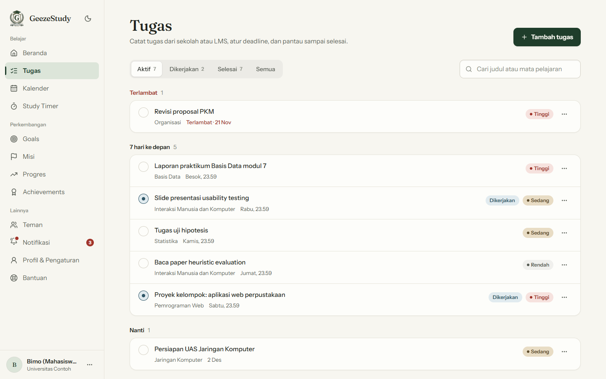

<p align="center">
  
</p>

<p align="center">
  
  
  
  
  
</p>

# GeezeStudy

Platform produktivitas akademik dengan gamifikasi ringan untuk pelajar SD, SMP, SMA, dan mahasiswa.
GeezeStudy **bukan LMS**: ia mendampingi tugas, jadwal, dan kebiasaan belajar yang datang dari LMS atau sekolah.

Gamifikasi hanya memakai lima komponen: **Points, Level, Streak, Missions, Achievements**.
Tidak ada chat, hewan peliharaan virtual, atau toko hadiah.

## Tampilan

Tersedia **mode terang dan gelap**. Pergantiannya berupa lingkaran yang melebar dari tombol yang diklik.

<p align="center">
  
</p>
<p align="center">
  
</p>

| Tugas | Kalender |
|---|---|
|  |  |
| **Study Timer** | **Progres** |
|  |  |
| **Achievements (gelap)** | **Masuk** |
|  |  |

<p align="center">
  
  &nbsp;&nbsp;
  
</p>

## Fitur

**Student**
- **Tugas**: dikelompokkan per tenggat, prioritas, pencarian dan filter, menu aksi dan klik kanan, konfirmasi sebelum hapus.
  Tiap tugas bisa diberi **lampiran** (satu berkas, maksimal 10 MB: PDF, Word, PowerPoint, Excel, gambar, atau ZIP).
- **Kalender**: tampilan bulan, minggu, dan hari; jadwal berulang; pengingat otomatis.
- **Study Timer**: sesi fokus yang divalidasi server (durasi, tumpang tindih, batas harian).
- **Goals dan Misi**: target harian atau mingguan dengan progres otomatis dari aktivitas nyata.
- **Progres dan Achievements**: Points, Level, dan Streak dihitung di server, bukan di klien.
- **Teman, Notifikasi, Profil**: peringkat teman, preferensi notifikasi dan jam tenang, foto profil opsional
  (bisa **dipotong dan di-zoom** sebelum diunggah, tersedia di Pengaturan).
- **Pengaturan**: profil, target belajar harian, privasi, tema (terang, gelap, otomatis).

**Akun**: masuk, daftar (tampil/sembunyikan password, indikator kekuatan password), lupa dan atur ulang password,
verifikasi email, onboarding singkat.

**Admin**: ringkasan, pengguna (tangguhkan, kirim tautan reset password), misi, Points dan level, achievements,
pengumuman, dan log audit.

**Desain**: terinspirasi minimalisme Apple, editorial, dan earthy (Warm Ivory, Forest Green, Sand Beige, Soft Sage).
Komponen kustom tanpa library tambahan: select (bisa dicari dan multi-pilih), date picker, time picker, menu dan
context menu, tooltip, dialog konfirmasi, modal, dan toast. Responsif penuh (navigasi bawah dan bottom sheet di HP),
mendukung `prefers-reduced-motion` dan navigasi keyboard.

## Teknologi

- **Frontend**: React 19, Vite 8, Tailwind CSS v4, React Router 7, Axios, Motion, Lucide.
- **Backend**: Laravel 13, PHP 8.3, Sanctum (cookie SPA), MySQL.
- Aturan gamifikasi (Points, misi, achievements, streak) hanya dijalankan di server.

## Menjalankan di komputer sendiri

Syarat: Node.js 22+, PHP 8.3, Composer, dan MySQL (mis. Laragon) yang sudah menyala.
Database `geezestudy` diatur di `backend/.env` (salin dari `backend/.env.example`).

Cara termudah di Windows: klik dua kali `jalankan-geezestudy.bat`. Skrip itu menyiapkan database lalu menyalakan
backend (http://localhost:8010) dan frontend (http://localhost:5173) di jendela terpisah.

Manual, dua terminal:

```bash
# Terminal 1 - backend
cd backend
composer install
php artisan key:generate   # hanya pertama kali, jika APP_KEY masih kosong
php artisan migrate --seed
composer serve             # php server + OPcache, jauh lebih cepat daripada php artisan serve

# Terminal 2 - frontend
cd frontend
npm install
npm run dev
```

Buka http://localhost:5173. Di halaman Masuk (mode dev) ada daftar akun uji yang bisa diklik. Semua password: `password123`.

| Peran | Email |
|---|---|
| Admin | admin@geezestudy.test |
| SD | sd@geezestudy.test |
| SMP | smp@geezestudy.test |
| SMA | sma@geezestudy.test |
| Mahasiswa | mahasiswa@geezestudy.test |

Akun ini hanya dibuat saat `APP_ENV=local`. Tiap akun Student berisi data demo sesuai jenjangnya (tugas, deadline, jadwal,
riwayat sesi belajar, goals, misi, achievements, teman, notifikasi). Points, level, dan streak dihitung dari aktivitas itu.
`php artisan db:seed` aman diulang: akun yang sudah terisi dilewati dan data buatanmu tidak disentuh.

Email verifikasi dan reset password di mode lokal tidak dikirim sungguhan: tautannya ditulis ke `backend/storage/logs/laravel.log`.

### Mencoba dari HP (satu Wi-Fi)

1. Cari IP laptop (mis. `192.168.1.3`).
2. `backend/.env`: `APP_URL=http://IP:8010`, `FRONTEND_URL=http://IP:5173`, `SANCTUM_STATEFUL_DOMAINS=IP:5173`, `SESSION_DOMAIN=` (kosong), lalu `php artisan config:clear`.
3. `frontend/.env.local`: `VITE_API_URL=http://IP:8010`.
4. Jalankan backend dengan `-S 0.0.0.0:8010` agar bisa diakses dari jaringan, lalu buka `http://IP:5173` di HP dan di laptop.

Kembalikan nilai `.env` semula setelah selesai.

### Tes dan lint

```bash
cd backend  && php artisan test    # tes fitur backend (SQLite in-memory)
cd frontend && npm run lint && npm run build
```

Pengingat deadline dan jadwal dibuat oleh `php artisan reminders:send` (dijadwalkan tiap 15 menit lewat scheduler Laravel).

## Struktur

```
frontend/src
├── components/   ui (design system), layout, dashboard, tasks, profile
├── pages/        halaman Student, auth/, admin/
├── context/      auth, tema, toast, konfirmasi
├── hooks/        useAuth, useTheme, useToast, useConfirm, useResource, useFloating
└── lib/          api, mappers, tanggal, navigasi, berkas, validasi
backend/
├── app/Http/Controllers/   API (Admin/ untuk panel admin)
├── app/Services/           aturan Points, misi, achievements, streak, sesi belajar
└── database/seeders/       data gamifikasi dan akun demo per jenjang
docs/                       banner dan screenshot README
```

## Hosting (checklist)

- **Frontend**: `npm run build` di `frontend`; set `VITE_API_URL` ke alamat API produksi (HTTPS) sebelum build. Base path lewat `VITE_BASE`.
  `frontend/vercel.json` sudah menyiapkan fallback SPA untuk Vercel.
- **Backend**: `APP_ENV=production`, `APP_DEBUG=false`, `APP_URL`, `FRONTEND_URL`, kredensial MySQL, `MAIL_*`
  (SMTP sungguhan agar email verifikasi dan reset terkirim), `php artisan migrate --force`, lalu
  `php artisan db:seed --class=GamificationSeeder --force` (tanpa akun contoh), `php artisan config:cache route:cache`.
- **Penyimpanan berkas**: lampiran tugas dan foto profil disimpan di disk server (`storage/app/private`). Pilih hosting dengan
  disk permanen, atau pindahkan disk `local` ke penyimpanan objek (S3, R2) agar berkas tidak hilang saat deploy ulang.
- Buat akun Admin pertama lewat `php artisan tinker` (set `role` = `admin`).
- **Cookie Sanctum SPA**: frontend dan API harus satu situs (mis. `app.contoh.id` dan `api.contoh.id`), lalu isi
  `SESSION_DOMAIN=.contoh.id`, `SANCTUM_STATEFUL_DOMAINS=app.contoh.id`, `SESSION_SECURE_COOKIE=true`, dan
  `FRONTEND_URL` + CORS ke alamat frontend.
- **Cron**: `* * * * * php artisan schedule:run` agar pengingat berjalan.

## Catatan batasan

- Sinkronisasi Google Calendar belum tersambung (pilihannya tersimpan, tetapi belum menyinkronkan apa pun).
- Satu tugas hanya bisa punya satu lampiran, dan belum ada pratinjau berkas di dalam aplikasi.
- Workflow `.github/workflows/deploy.yml` hanya mem-build frontend untuk GitHub Pages. Tanpa backend publik, login tidak
  akan berfungsi di sana. Aktifkan di Settings, Pages, Source: GitHub Actions bila diperlukan.
