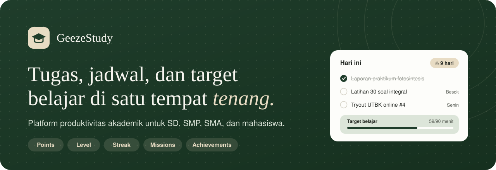
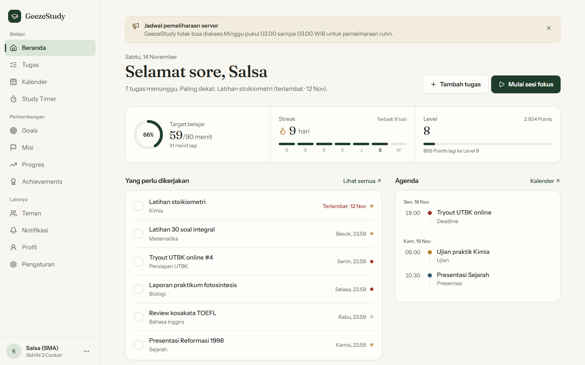
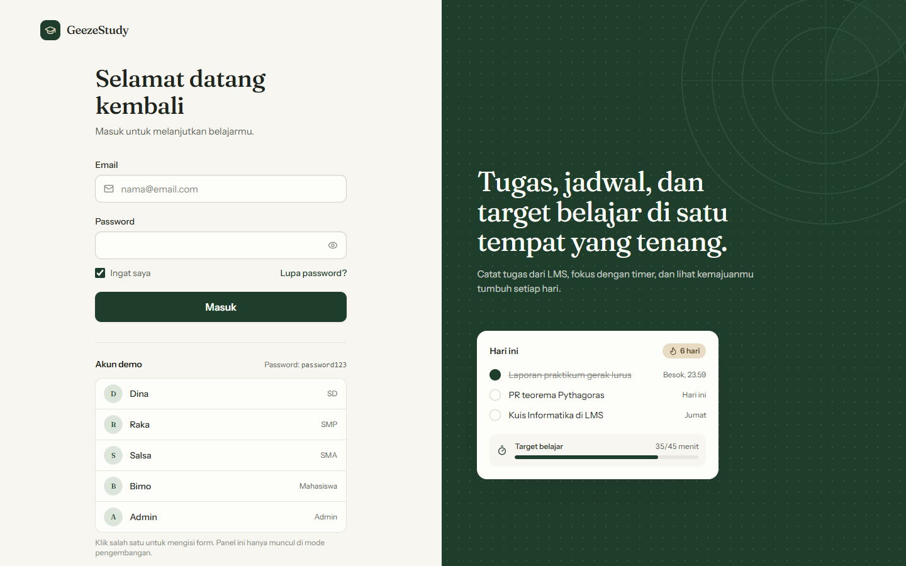
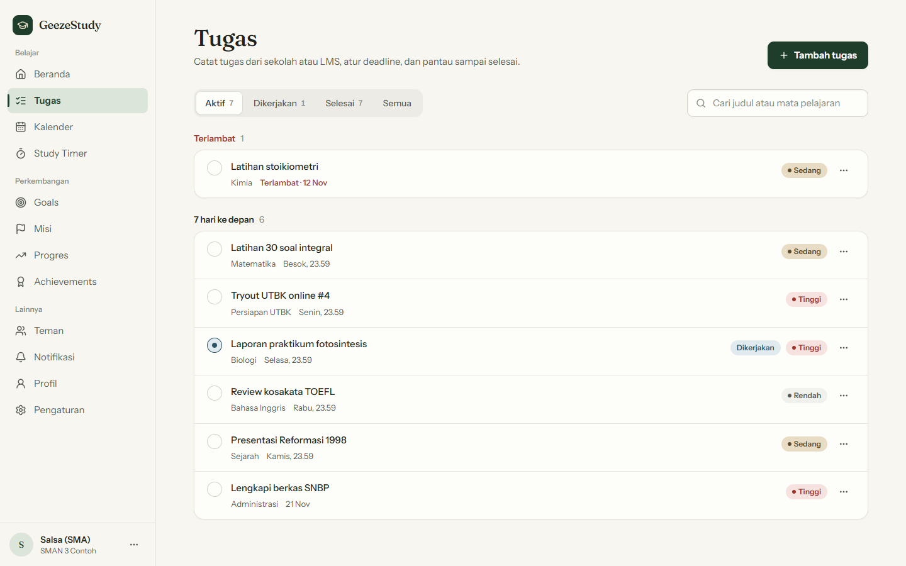
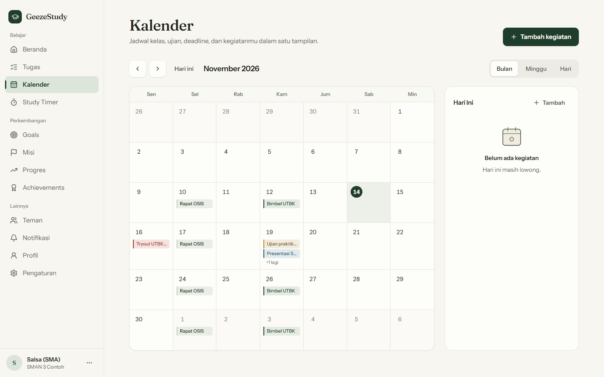
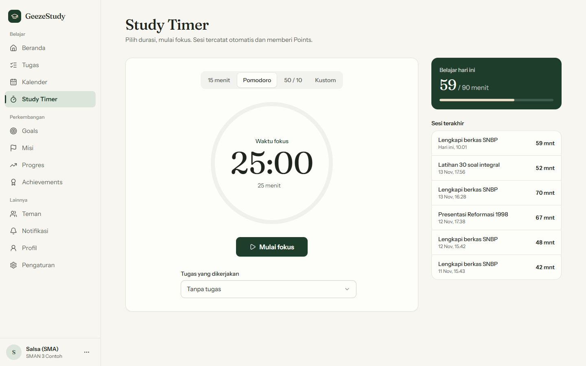
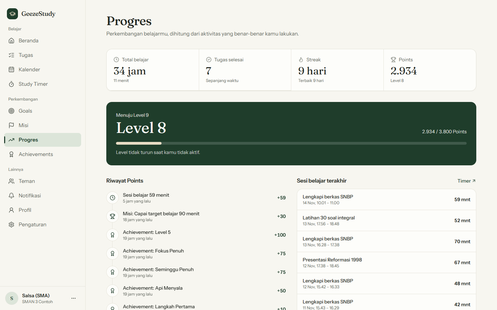
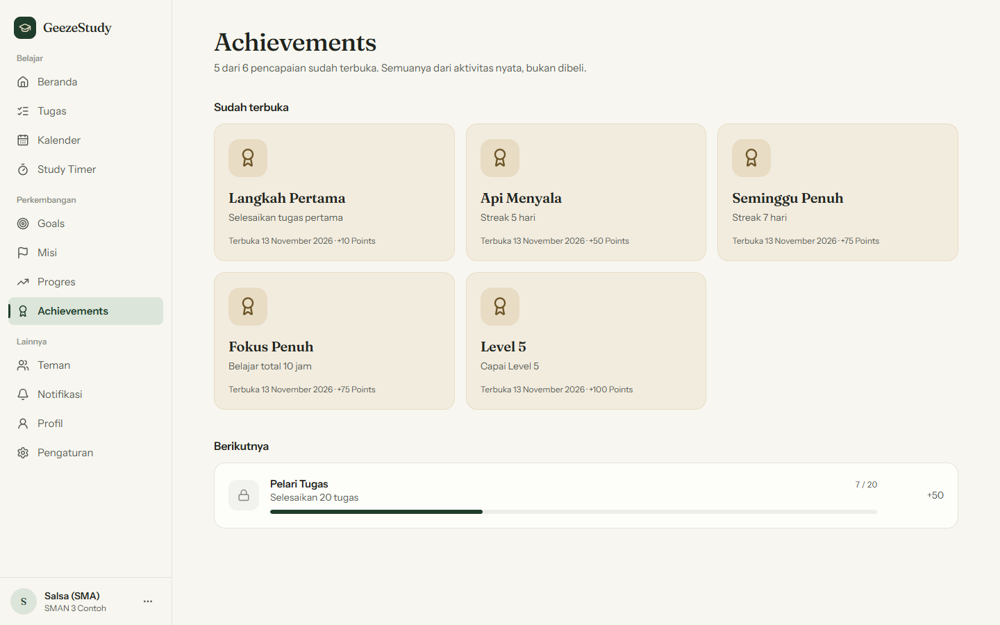
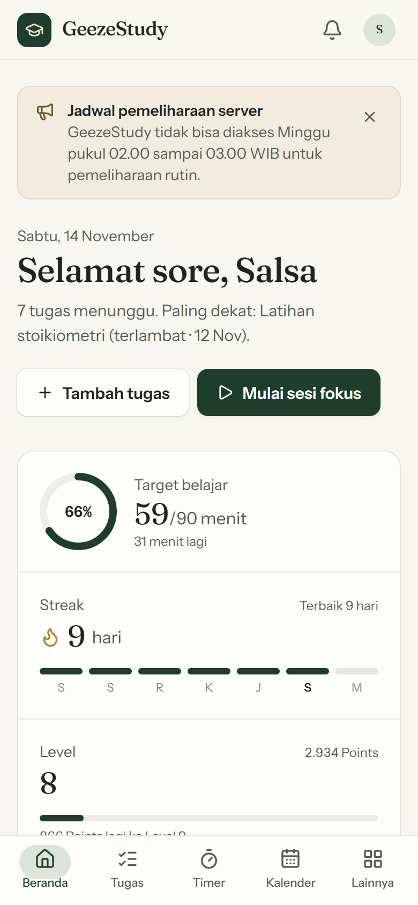

<p align="center">
  
</p>

<p align="center">
  
  
  
  
  
</p>

# GeezeStudy

Platform produktivitas akademik dengan gamifikasi ringan untuk pelajar SD, SMP, SMA, dan mahasiswa.
GeezeStudy **bukan LMS**: ia mendampingi tugas, jadwal, dan kebiasaan belajar yang datang dari LMS atau sekolah.

Gamifikasi hanya memakai lima komponen: **Points, Level, Streak, Missions, Achievements**.

## Tampilan

<p align="center">
  
</p>

| Masuk | Tugas |
|---|---|
|  |  |
| **Kalender** | **Study Timer** |
|  |  |
| **Progres** | **Achievements** |
|  |  |

<p align="center">
  
</p>

## Fitur utama

- **Tugas**: dikelompokkan per tenggat, prioritas, pencarian, menu klik kanan, konfirmasi sebelum hapus.
- **Kalender**: tampilan bulan, minggu, dan hari; jadwal berulang; pengingat otomatis.
- **Study Timer**: sesi fokus yang divalidasi server (durasi, tumpang tindih, batas harian).
- **Goals dan Misi**: target harian/mingguan dengan progres otomatis dari aktivitas nyata.
- **Progres dan Achievements**: Points, Level, dan Streak dihitung di server.
- **Teman, Notifikasi, Profil**: papan peringkat teman, preferensi notifikasi, foto profil opsional.
- **Admin**: kelola pengguna, misi, achievements, pengumuman, dan log audit.
- Responsif penuh: navigasi bawah dan modal bottom sheet di HP.

## Status

Frontend dan backend sudah tersambung dan berfungsi penuh (login nyata, data tersimpan di MySQL).
Yang tersisa tinggal hosting (lihat bagian Hosting).

## Menjalankan semuanya (lokal)

Syarat: Node.js 22+, PHP 8.3, Composer, dan MySQL (Laragon) yang sudah menyala.
Database `geezestudy` diatur di `backend/.env`.

Cara termudah di Windows: klik dua kali `jalankan-geezestudy.bat`. Skrip itu menyiapkan database, menyalakan backend
(http://localhost:8010) di jendela terpisah, dan frontend (http://localhost:5173).

Manual, dua terminal:

```bash
# Terminal 1 - backend
cd backend
composer install
php artisan migrate --seed
composer serve            # php server + OPcache, jauh lebih cepat daripada php artisan serve

# Terminal 2 - frontend
cd frontend
npm install
npm run dev
```

Buka http://localhost:5173. Di halaman Masuk (mode dev) ada tombol akun uji. Semua password: `password123`.

| Peran | Email |
|---|---|
| Admin | admin@geezestudy.test |
| SD | sd@geezestudy.test |
| SMP | smp@geezestudy.test |
| SMA | sma@geezestudy.test |
| Mahasiswa | mahasiswa@geezestudy.test |

Akun ini hanya dibuat saat `APP_ENV=local`. Tiap akun Student berisi data demo sesuai jenjangnya (tugas, deadline, jadwal,
riwayat sesi belajar, goals, misi, achievements, teman, notifikasi). Points, level, dan streak dihitung dari aktivitas itu.
`php artisan db:seed` aman diulang: akun yang sudah terisi dilewati dan data buatanmu tidak disentuh.
Tes backend: `cd backend && php artisan test`.

Pengingat deadline/jadwal dibuat oleh `php artisan reminders:send` (dijadwalkan tiap 15 menit lewat scheduler Laravel).

## Hosting (checklist)

- Frontend: `npm run build` di `frontend`, set `VITE_API_URL` ke alamat API produksi (HTTPS) sebelum build. Base path lewat `VITE_BASE`.
- Backend: `APP_ENV=production`, `APP_DEBUG=false`, `APP_URL`, `FRONTEND_URL`, kredensial MySQL, `MAIL_*` (SMTP sungguhan agar email verifikasi/reset terkirim), `php artisan migrate --force` lalu `php artisan db:seed --class=GamificationSeeder --force` (tanpa akun contoh), `php artisan config:cache route:cache`.
- Buat akun Admin pertama lewat `php artisan tinker` (set `role` = `admin`).
- Cookie Sanctum SPA: frontend dan API harus satu situs (mis. `app.contoh.id` dan `api.contoh.id`), lalu isi `SESSION_DOMAIN=.contoh.id`, `SANCTUM_STATEFUL_DOMAINS=app.contoh.id`, `SESSION_SECURE_COOKIE=true`, dan `FRONTEND_URL` + CORS ke alamat frontend.
- Cron: `* * * * * php artisan schedule:run` agar pengingat berjalan.

## Catatan batasan

Unggah lampiran tugas belum ada (hanya nama berkas), dan sinkronisasi Google Calendar belum tersambung (pilihannya tersimpan).

## Fitur yang sudah ada

Student: Beranda, Tugas (cari, filter, kelompok tenggat, menu aksi dan klik kanan), Kalender (bulan/minggu/hari, kegiatan rutin,
pengingat), Study Timer, Goals (otomatis atau manual), Misi harian dan mingguan, Progres, Achievements, Profil, Teman,
Notifikasi (preferensi dan jam tenang), Pengaturan (foto profil opsional, profil, target harian, privasi).

Akun: masuk, daftar (foto profil opsional, show/hide password, indikator kekuatan password), lupa dan atur ulang password,
verifikasi email, onboarding singkat.

Admin: ringkasan, pengguna (tangguhkan, kirim tautan reset password), misi, Points dan level, achievements, pengumuman, log.

Desain: Warm Ivory, Forest Green, Sand Beige. Komponen custom tanpa library tambahan: select (bisa dicari dan multi-pilih),
date picker, time picker, menu dan context menu, tooltip, dialog konfirmasi, toast (sukses, galat, peringatan, info, loading).

## Teknologi

- Frontend: React 19, Vite, Tailwind CSS v4, React Router, Motion, Lucide.
- Backend: Laravel 13, Sanctum, MySQL.
- Desain: Colorful Neobrutalism. Mendukung `prefers-reduced-motion`, navigasi keyboard, dan responsif.

## Struktur

```
frontend/src
├── components/   ui, layout, dashboard, tasks
├── pages/        halaman Student, auth/, admin/
├── context/      auth demo, pengumuman
├── hooks/        useAuth, useToast, useAnnouncements
└── lib/          navigasi, tanggal, data contoh
backend/          Laravel API (app/Services = aturan Points, misi, achievements, streak)
```

## Deploy

Workflow `.github/workflows/deploy.yml` hanya mem-build frontend untuk GitHub Pages; tanpa backend publik, login tidak akan berfungsi di sana.
Aktifkan di Settings, Pages, Source: GitHub Actions.
