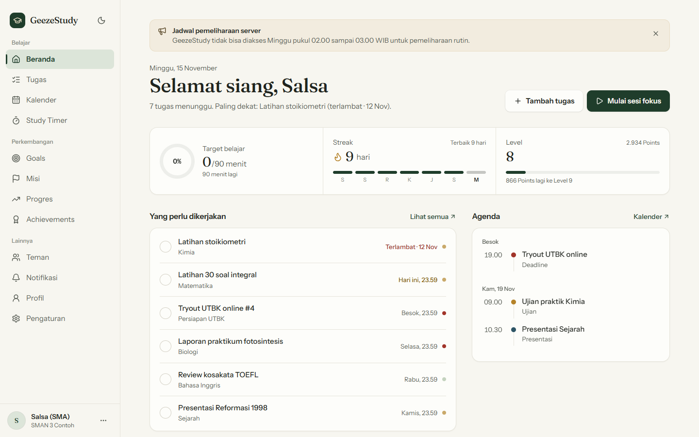
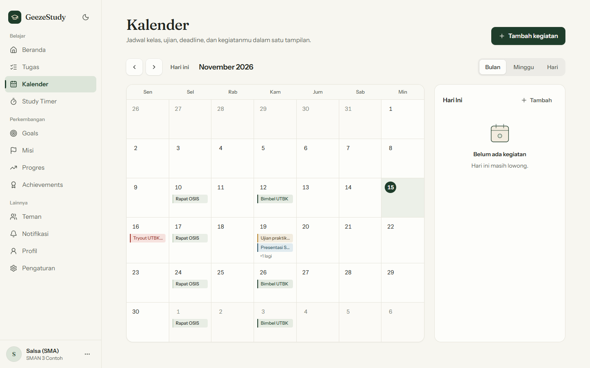
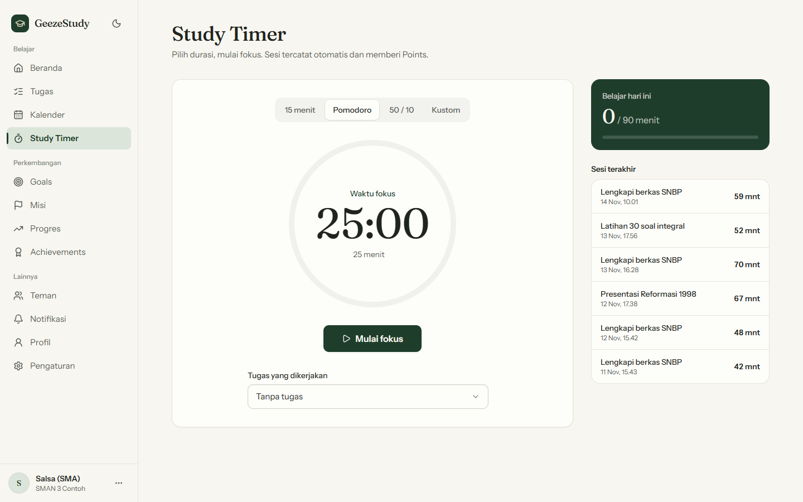
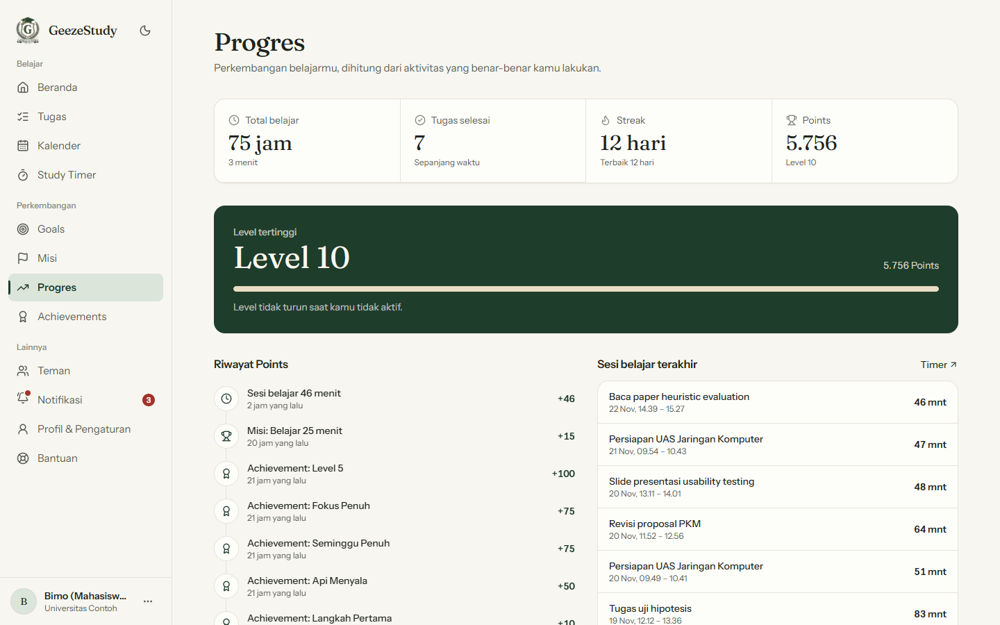
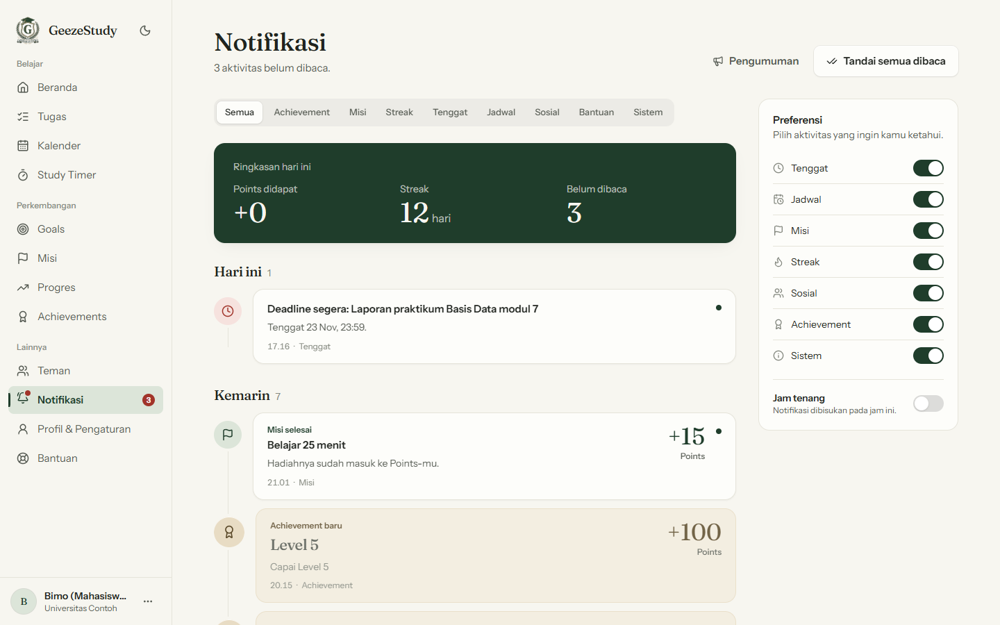
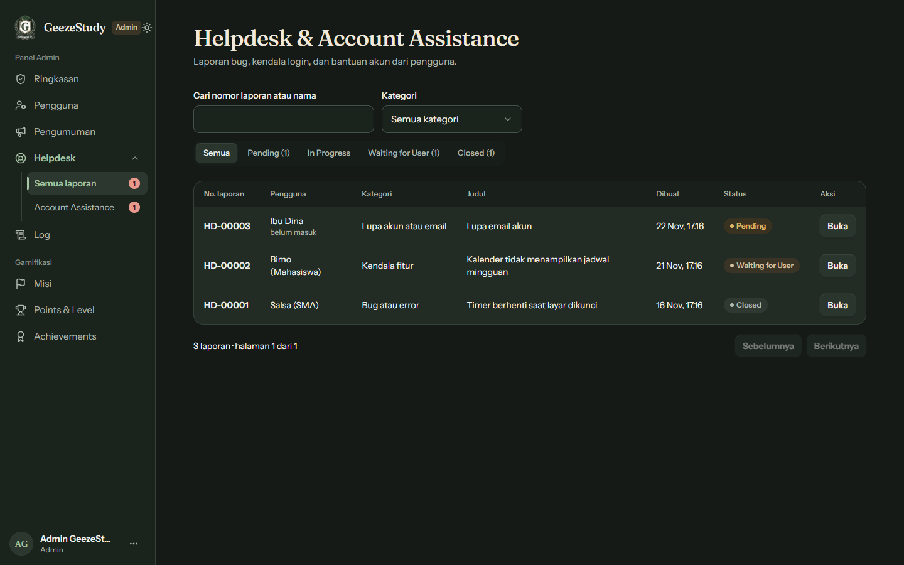
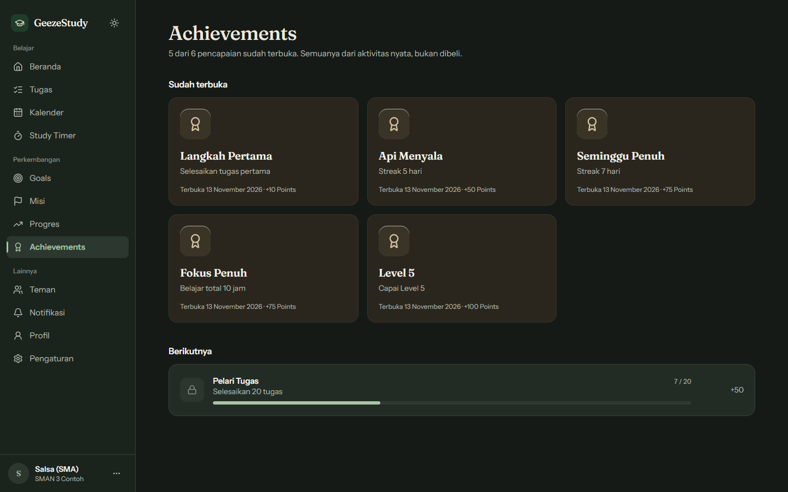
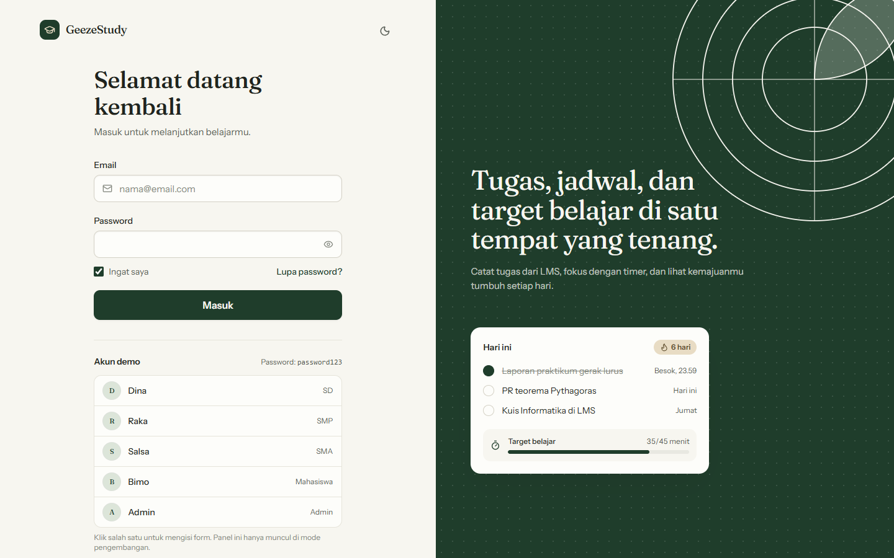
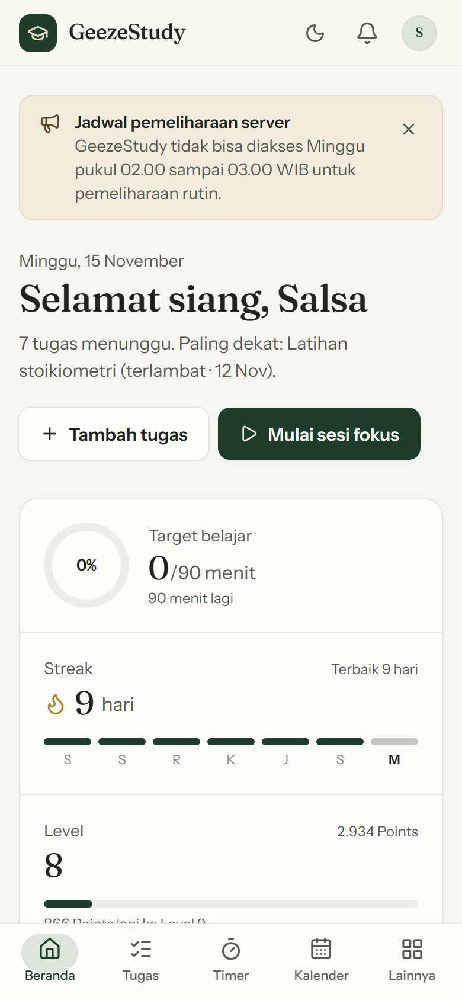
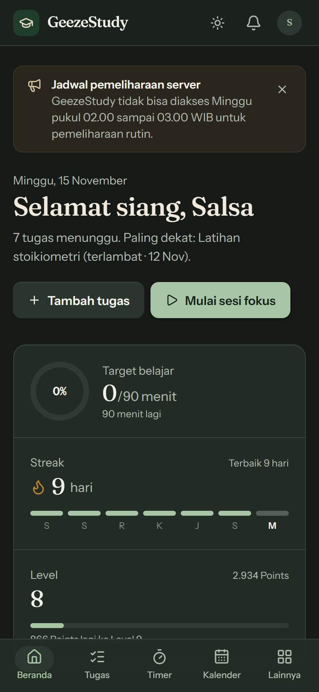

<p align="center">
  
</p>

<p align="center">
  
  
  
  
  
</p>

# GeezeStudy

Platform produktivitas akademik dengan gamifikasi ringan untuk pelajar SD, SMP, SMA, dan mahasiswa.
GeezeStudy **bukan LMS**: ia mendampingi tugas, jadwal, dan kebiasaan belajar yang datang dari LMS atau sekolah.

Gamifikasi hanya memakai lima komponen: **Points, Level, Streak, Missions, Achievements**.
Tidak ada chat, hewan peliharaan virtual, atau toko hadiah.

## Tampilan

Tersedia **mode terang dan gelap**. Pergantiannya berupa lingkaran yang melebar dari tombol yang diklik.
Setiap kali situs dibuka, lambang GeezeStudy tampil di **splash screen** singkat sampai halaman siap.

<p align="center">
  
</p>
<p align="center">
  
</p>

| Tugas | Kalender |
|---|---|
|  |  |
| **Study Timer** | **Progres** |
|  |  |
| **Notifikasi** | **Helpdesk Admin (gelap)** |
|  |  |
| **Achievements (gelap)** | **Masuk** |
|  |  |

<p align="center">
  
  &nbsp;&nbsp;
  
</p>

## Fitur

**Student**
- **Tugas**: dikelompokkan per tenggat, prioritas, pencarian dan filter, menu aksi dan klik kanan, konfirmasi sebelum hapus.
  Tiap tugas bisa diberi **lampiran** (satu berkas, maksimal 10 MB: PDF, Word, PowerPoint, Excel, gambar, atau ZIP).
- **Kalender**: tampilan bulan, minggu, dan hari; jadwal berulang; pengingat otomatis.
- **Study Timer**: sesi fokus yang divalidasi server (durasi, tumpang tindih, batas harian).
- **Goals dan Misi**: target harian atau mingguan dengan progres otomatis dari aktivitas nyata.
- **Progres dan Achievements**: Points, Level, dan Streak dihitung di server, bukan di klien.
- **Teman**: peringkat teman berdasarkan jam belajar minggu ini (tanpa chat, hanya statistik).
- **Notifikasi**: ringkasan hari ini, lalu linimasa per hari (Hari ini, Kemarin, Sebelumnya). Misi dan achievement menampilkan
  Points yang didapat, streak dirayakan, dengan preferensi per jenis dan jam tenang. Lencana belum dibaca di menu, dan pop-up saat ada
  pembaruan baru.
- **Profil & Pengaturan**: ringkasan profil, lalu profil, foto profil opsional (bisa **dipotong dan di-zoom**), target belajar harian,
  privasi, tema (terang, gelap, otomatis), dan **keamanan** (ganti password) dalam satu menu.
- **Pengumuman**: informasi resmi dari Admin tampil sebagai banner di Beranda; yang sudah ditutup tidak muncul lagi, dan semuanya bisa dibaca di riwayat pengumuman.
- **Bantuan (Helpdesk)**: kirim laporan bug, kendala login, atau pertanyaan (dengan screenshot opsional), dapat nomor laporan, lalu pantau status dan balasan admin.

**Akun**: masuk, daftar sebagai Student (tampil/sembunyikan password, indikator kekuatan password), lupa dan atur ulang password,
verifikasi email, onboarding singkat, ganti email (butuh password saat ini) dan ganti password. Yang tidak bisa masuk (lupa email,
akun tidak bisa diakses) bisa mengirim permintaan lewat **Bantuan akun** tanpa login; balasan admin dikirim ke email kontak.
Tidak ada pendaftaran Admin. Lihat [Alur akun](#alur-akun-ganti-dan-lupa-email-atau-password).

**Admin**: ringkasan, pengguna (tangguhkan, atur **password sementara** yang wajib diganti pengguna saat masuk), misi, Points dan level, achievements,
pengumuman, log audit, dan **Helpdesk & Account Assistance** (laporan, balasan, status, dan pemulihan email akun setelah kepemilikan diverifikasi).

**Desain**: terinspirasi minimalisme Apple, editorial, dan earthy (Warm Ivory, Forest Green, Sand Beige, Soft Sage).
Komponen kustom tanpa library tambahan: select (bisa dicari dan multi-pilih), date picker, time picker, menu dan
context menu, tooltip, dialog konfirmasi, modal, dan toast (termasuk toast hadiah Points). Ikon menu bergerak halus saat diklik.
Responsif penuh (navigasi bawah dan bottom sheet di HP),
mendukung `prefers-reduced-motion` dan navigasi keyboard.

## Teknologi

- **Frontend**: React 19, Vite 8, Tailwind CSS v4, React Router 7, Axios, Motion, Lucide.
- **Backend**: Laravel 13, PHP 8.3, Sanctum (cookie SPA), MySQL.
- Aturan gamifikasi (Points, misi, achievements, streak) hanya dijalankan di server.

## Menjalankan di komputer sendiri

Syarat: Node.js 22+, PHP 8.3, Composer, dan MySQL (mis. Laragon) yang sudah menyala.
Database `geezestudy` diatur di `backend/.env` (salin dari `backend/.env.example`).

Cara termudah di Windows: klik dua kali `jalankan-geezestudy.bat`. Skrip itu menyiapkan database lalu menyalakan
backend (http://localhost:8010) dan frontend (http://localhost:5173) di jendela terpisah.

Manual, dua terminal:

```bash
# Terminal 1 - backend
cd backend
composer install
php artisan key:generate   # hanya pertama kali, jika APP_KEY masih kosong
php artisan migrate --seed
composer serve             # php server + OPcache, jauh lebih cepat daripada php artisan serve

# Terminal 2 - frontend
cd frontend
npm install
npm run dev
```

Buka http://localhost:5173 dan masuk dengan salah satu akun demo di bawah. Semua password: `password123`.

| Peran | Email | Isi data demo |
|---|---|---|
| Admin | admin@geezestudy.test | Panel Admin: pengguna, laporan Helpdesk, pengumuman, log |
| SD | sd@geezestudy.test | Level 5, streak 4 hari |
| SMP | smp@geezestudy.test | Level 7, streak 6 hari |
| SMA | sma@geezestudy.test | Level 8, streak 9 hari |
| Mahasiswa | mahasiswa@geezestudy.test | Level 10, streak 12 hari |

Akun ini hanya dibuat saat `APP_ENV=local`, dan tidak ada pendaftaran Admin: akun Admin dibuat oleh seeder.
Tiap akun Student berisi 1 sampai 2 bulan riwayat sesuai jenjangnya: tugas, deadline, jadwal, sesi belajar, goals, misi,
achievements, teman, notifikasi aktivitas, dan contoh laporan Helpdesk. Points, level, dan streak dihitung dari aktivitas itu,
dan tanggalnya relatif terhadap hari dijalankan, jadi dashboard selalu tampak terkini.

### Setelah `git pull` (anggota tim)

```bash
cd backend
composer install                   # bila ada paket baru
php artisan migrate:fresh --seed   # MENGHAPUS isi database lokal, lalu mengisi ulang data demo
cd ../frontend
npm install
npm run dev
```

Ingin mempertahankan data lokalmu? Pakai `php artisan migrate --seed`: akun demo yang sudah terisi dilewati dan data buatanmu
tidak disentuh. Tidak perlu bertukar file `.sql`.

Kalau memang menerima file `.sql` demo dari anggota tim: buat database kosong, impor filenya, lalu samakan `DB_DATABASE` di
`backend/.env`. Tanggal di file `.sql` terkunci pada hari file dibuat, jadi untuk data yang selalu terkini lebih baik pakai seeder.

### Alur akun: ganti dan lupa email atau password

| Situasi | Yang dilakukan |
|---|---|
| Ingin ganti password | Profil & Pengaturan, tab Pengaturan, bagian Keamanan: isi password saat ini lalu password baru. Sesi di perangkat lain dikeluarkan. |
| Ingin ganti email | Profil & Pengaturan: isi email baru **dan password saat ini**, lalu buka tautan verifikasi di email baru. |
| Lupa password, email masih bisa dibuka | Halaman Masuk, "Lupa password?": tautan reset dikirim ke email, lalu buat password baru sendiri. |
| Lupa email atau email tidak bisa dibuka | Halaman Masuk, "Lupa email atau tidak bisa mengakses akun?": kirim permintaan ke Helpdesk. Admin memverifikasi kepemilikan, lalu mengganti email akun ke email kontak yang dikirim. Setelah itu pakai "Lupa password?". |
| Admin membantu langsung | Admin mengatur **password sementara** di menu Pengguna. Saat masuk, pengguna **wajib** membuat password baru sebelum bisa memakai aplikasi, jadi Admin tidak pernah tahu password akhirnya. |

Admin tidak bisa melihat password siapa pun, dan semua tindakan Admin pada akun tercatat di Log.

Email verifikasi dan reset password di mode lokal tidak dikirim sungguhan: tautannya ditulis ke `backend/storage/logs/laravel.log`.

### Mencoba dari HP (satu Wi-Fi)

1. Cari IP laptop (mis. `192.168.1.3`).
2. `backend/.env`: `APP_URL=http://IP:8010`, `FRONTEND_URL=http://IP:5173`, `SANCTUM_STATEFUL_DOMAINS=IP:5173`, `SESSION_DOMAIN=` (kosong), lalu `php artisan config:clear`.
3. `frontend/.env.local`: `VITE_API_URL=http://IP:8010`.
4. Jalankan backend dengan `-S 0.0.0.0:8010` agar bisa diakses dari jaringan, lalu buka `http://IP:5173` di HP dan di laptop.

Kembalikan nilai `.env` semula setelah selesai.

### Tes dan lint

```bash
cd backend  && php artisan test    # tes fitur backend (SQLite in-memory)
cd frontend && npm run lint && npm run build
```

Pengingat deadline dan jadwal dibuat oleh `php artisan reminders:send` (dijadwalkan tiap 15 menit lewat scheduler Laravel).

## Struktur

```
frontend/src
├── components/   ui (design system), layout, dashboard, tasks, profile
├── pages/        halaman Student, auth/, admin/
├── context/      auth, tema, toast, konfirmasi
├── hooks/        useAuth, useTheme, useToast, useConfirm, useResource, useFloating
└── lib/          api, mappers, tanggal, navigasi, berkas, validasi
backend/
├── app/Http/Controllers/   API (Admin/ untuk panel admin)
├── app/Services/           aturan Points, misi, achievements, streak, sesi belajar
└── database/seeders/       data gamifikasi dan akun demo per jenjang
docs/                       banner dan screenshot README
```

## Hosting (checklist)

- **Frontend**: `npm run build` di `frontend`; set `VITE_API_URL` ke alamat API produksi (HTTPS) sebelum build. Base path lewat `VITE_BASE`.
  `frontend/vercel.json` sudah menyiapkan fallback SPA untuk Vercel.
- **Backend**: `APP_ENV=production`, `APP_DEBUG=false`, `APP_URL`, `FRONTEND_URL`, kredensial MySQL, `MAIL_*`
  (SMTP sungguhan agar email verifikasi dan reset terkirim), `php artisan migrate --force`, lalu
  `php artisan db:seed --class=GamificationSeeder --force` (tanpa akun contoh), `php artisan config:cache route:cache`.
- **Penyimpanan berkas**: lampiran tugas, lampiran laporan Helpdesk, dan foto profil memakai disk bawaan Laravel (`FILESYSTEM_DISK`).
  Bawaannya `local` (`storage/app/private`), cocok untuk hosting dengan disk permanen. Untuk S3 atau yang kompatibel (mis. Cloudflare R2),
  isi `FILESYSTEM_DISK=s3` beserta `AWS_ACCESS_KEY_ID`, `AWS_SECRET_ACCESS_KEY`, `AWS_DEFAULT_REGION`, `AWS_BUCKET` (dan `AWS_ENDPOINT`
  untuk R2). Berkas lama di disk lokal tidak pindah otomatis.
- Buat akun Admin pertama lewat `php artisan tinker` (set `role` = `admin`).
- **Cookie Sanctum SPA**: frontend dan API harus satu situs (mis. `app.contoh.id` dan `api.contoh.id`), lalu isi
  `SESSION_DOMAIN=.contoh.id`, `SANCTUM_STATEFUL_DOMAINS=app.contoh.id`, `SESSION_SECURE_COOKIE=true`, dan
  `FRONTEND_URL` + CORS ke alamat frontend.
- **Cron**: `* * * * * php artisan schedule:run` agar pengingat berjalan.
- **Captcha (opsional)**: Cloudflare Turnstile di halaman masuk, daftar, lupa dan atur ulang password. Aktif hanya jika
  `VITE_TURNSTILE_SITE_KEY` (frontend, saat build) dan `TURNSTILE_SECRET_KEY` (backend) diisi; tanpa keduanya captcha dilewati,
  jadi pengembangan lokal tidak terpengaruh. Jika backend berada di balik reverse proxy, proxy tepercaya sudah diatur di `bootstrap/app.php`.

## Catatan batasan

- Sinkronisasi Google Calendar belum tersambung (pilihannya tersimpan, tetapi belum menyinkronkan apa pun).
- Pengunjung yang belum punya akses hanya menerima balasan Helpdesk lewat email, jadi hosting perlu SMTP sungguhan. Pemulihan email hanya mengganti email ke alamat kontak pelapor setelah admin memverifikasi kepemilikan; password tidak pernah dilihat admin.
- Satu tugas hanya bisa punya satu lampiran, dan belum ada pratinjau berkas di dalam aplikasi.
- Workflow `.github/workflows/deploy.yml` hanya mem-build frontend untuk GitHub Pages. Tanpa backend publik, login tidak
  akan berfungsi di sana. Aktifkan di Settings, Pages, Source: GitHub Actions bila diperlukan.
